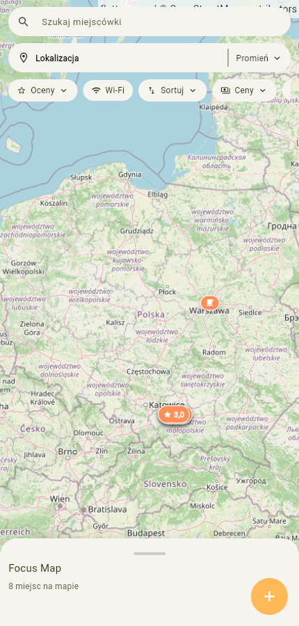
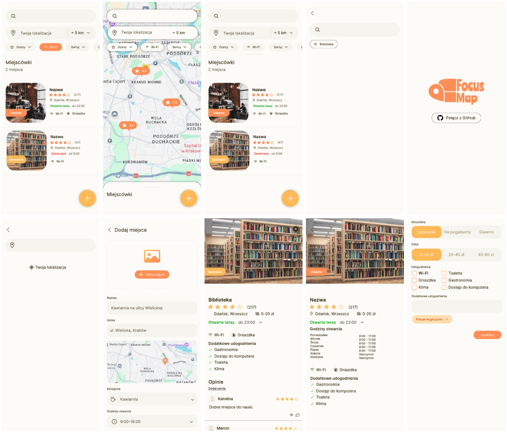

<p align="center">
  
</p>

<h3 align="center">Mapa miejsc do nauki i pracy — kawiarni, bibliotek i innych „trzecich miejsc”</h3>

<p align="center">
  <a href="https://thirdplaces.pl"><b>▶ thirdplaces.pl</b></a> ·
  <a href="https://api.thirdplaces.pl/docs">API (Swagger)</a> ·
  projekt z hackathonu <b>HackYeah 2026</b>
</p>

<p align="center">
  
  
  
  
  
</p>

**Focus Map** pomaga znaleźć miejsce, w którym da się spokojnie posiedzieć z laptopem: kawiarnię z Wi-Fi
i gniazdkami, cichą bibliotekę albo coworking. Na mapie widać oceny, ceny, godziny otwarcia i atmosferę
miejsca, a społeczność dodaje nowe miejscówki, zdjęcia i opinie.

<p align="center">
  
</p>

<details open>
<summary><b>Projekt interfejsu (Figma)</b></summary>



</details>

## Funkcje

- **Mapa i lista miejscówek** (OpenStreetMap, `flutter_map`) z wyszukiwaniem miasta/adresu, „Moją lokalizacją”
  i promieniem wyszukiwania.
- **Filtry i sortowanie** — oceny, Wi-Fi, gniazdka, przedział cen, atmosfera (*spokojnie / na pogaduchy / gwarno*),
  udogodnienia (toaleta, klima, gastronomia, dostęp do komputera…).
- **Godziny otwarcia** ze statusem „otwarte teraz / zamknięte”, parsowane także z danych OSM.
- **Opinie z gwiazdkami**, polubienia komentarzy, oceny w kategoriach.
- **Dodawanie miejsc** ze zdjęciami i wyborem lokalizacji na mapie; nowe miejsca zatwierdza **panel admina**.
- **Logowanie przez GitHub i Google** (OAuth), własne tokeny Bearer, rate limiting.
- **Import danych z OpenStreetMap** (Overpass API) jako realistyczne dane startowe.
- **CI/CD** — testy (pytest) i budowanie obrazów Dockera w GitHub Actions, wdrożenie na Raspberry Pi
  za tunelem Cloudflare (szczegóły: [`docs/DEPLOY.md`](docs/DEPLOY.md)).

## Architektura

```
Flutter (web / Android) ──HTTPS──► FastAPI ──► MongoDB Atlas
        frontend/                    app/         zdjęcia: dysk lub Cloudinary
                                     │
                         OAuth: GitHub, Google · geokodowanie · import OSM
```

| Katalog | Zawartość |
|---|---|
| `app/` | backend FastAPI: routery (`places`, `ratings`, `comments`, `photos`, `auth`, `admin`, `geocode`), modele, repozytoria |
| `frontend/` | aplikacja Flutter (mapa, lista, szczegóły, dodawanie miejsc, panel admina) — [README frontu](frontend/README.md) |
| `scripts/` | import z OSM i dane testowe |
| `tests/` | testy API (pytest) |
| `deploy/` | Dockerfile, nginx, docker-compose dla Raspberry Pi |
| `docs/` | dokumentacja: auth, integracja z frontem, wdrożenie |

## Autorzy

- Natalia Płocha
- Lucjan Butko
- Krzysztof Toczyński
- Michał Kopczewski

## Uruchomienie backendu

```bash
pip install -r requirements.txt
cp .env.example .env                      # i uzupełnij dane do bazy
fastapi dev app/main.py                   # http://127.0.0.1:8000/docs
```

Healthcheck: `GET /health` (szczegóły: `GET /health/details`). Na produkcji z domeny frontu: `/_fm/s7k2q-hc`
– JSON z połączeniem front → API → baza, opis w [`docs/DEPLOY.md`](docs/DEPLOY.md#healthcheck-z-zewnątrz).
Konfiguracja w `.env` (patrz `.env.example`).

### Baza danych

Domyślnie backend łączy się ze zdalnym MongoDB (Atlas) z `MONGODB_URI`.
Lokalny Mongo w kontenerze:

```bash
docker compose up -d                      # MongoDB na localhost:27017 (root / example)
# w .env:
USE_REMOTE_MONGO=false
```

### Logowanie

GitHub i Google przez OAuth; backend wystawia własny token (`Authorization: Bearer ...`).
Odczyt publiczny, zapis wymaga logowania; komentarze edytuje/usuwa autor albo admin.
Konfiguracja i testowanie bez frontu: [`docs/AUTH.md`](docs/AUTH.md).

### Integracja z frontem

CORS, logowanie, wyszukiwanie, zdjęcia, paginacja, błędy: [`docs/FRONTEND.md`](docs/FRONTEND.md).

### Dane testowe

```bash
python scripts/import_osm.py              # 30 prawdziwych kawiarni i restauracji z Krakowa (OSM) + dane mock
python scripts/seed.py                    # albo 6 wymyślonych miejsc z examples/places/
```

Oba piszą do bazy wybranej w `.env` i oznaczają wszystko `is_mock: true`; przed startem usuwają
**wszystkie** poprzednie dane mock (prawdziwych nie ruszają). Przy imporcie z OSM nazwa, adres,
współrzędne, godziny i tagi OSM są prawdziwe, a `mock_fields` wymienia pola wymyślone.
Dane OSM są w repo jako snapshot (`data/osm/`, © OpenStreetMap contributors, ODbL);
`--refresh` pobiera świeże z Overpass API.
Usunięcie danych mock w Compass: filtr `{ "is_mock": true }` w kolekcjach `places`, `ratings`, `comments`.

### Przykłady

- curl: [`examples/README.md`](examples/README.md)
- Postman: [`postman/README.md`](postman/README.md)

## Wdrożenie (Render)

Oba serwisy opisuje [`render.yaml`](render.yaml):

- `focusmap-api`: backend, https://focusmap-api-6spc.onrender.com
- `focusmap`: frontend Flutter web, https://focusmap-6spc.onrender.com (działa w przeglądarce telefonu)

Pierwsze uruchomienie: Render Dashboard → **New → Blueprint** → to repo, potem wpisz `MONGODB_URI`.
Każdy push na wybraną gałąź wdraża się sam.

- MongoDB Atlas → Security → Network Access: dodaj `0.0.0.0/0`, bo Render (plan free) nie ma stałego IP.
- Jeśli Render nada inne adresy niż powyższe, popraw `API_URL`, `CORS_ORIGINS` i `PUBLIC_BASE_URL`.
- Plan free usypia backend po 15 min bez ruchu; pierwsze zapytanie po przerwie trwa do ~1 min.
- Zdjęcia trzymamy w Cloudinary (`CLOUDINARY_URL` w Dashboardzie), więc przetrwają wdrożenia. Bez tej zmiennej lądują na dysku serwisu i znikają przy każdym deployu.

## Testy

```bash
docker compose up -d
pip install -r requirements-dev.txt
pytest
```

Testy zawsze używają kontenera (baza `hackyeah_test`, usuwana po testach), niezależnie od `.env`.
